# Follow Down — Game Design Document

[← Volver al README](README.md)

**Grupo I** · Álvaro Montero Carrasco, Carla Urdiales Aguado, Jorge Franco López de Gauna

## Índice

1. [Introducción](#1-introducción)
2. [Especificaciones básicas](#2-especificaciones-básicas)
3. [Jugabilidad](#3-jugabilidad)
4. [Narrativa](#4-narrativa)
5. [Imagen y diseño visual](#5-imagen-y-diseño-visual)
6. [Sonido](#6-sonido)
7. [Interfaz y diagrama de flujo](#7-interfaz-y-diagrama-de-flujo)
8. [Comunicación y marketing](#8-comunicación-y-marketing)
9. [Referencias](#9-referencias)

> **Nota para el alumnado:** este documento es una **plantilla de ejemplo**. Sustituid todos los textos `AAA`, `BBB`, `CCC`... y las imágenes de `img/` por vuestro contenido. Los bloques como este, que empiezan por *Rúbrica*, indican qué criterio de evaluación cubre cada apartado: **borradlos antes de entregar**. Límite orientativo: **3500 palabras**. Todo el documento debe estar en castellano (mezclar idiomas penaliza).

---

## 1. Introducción

### 1.1. Concepto del juego

Follow Down es un juego multijugador de puzles y plataformas cooperativo para 2 o más jugadores en el que deben unir fuerzas (o no!) a través de distintos niveles con diferentes temáticas, resolviendo distintos puzles y parkours. La idea principal es un juego cooperativo de plataformas, puzles cooperativos donde deben buscarse coleccionables a través de los distintos niveles. La comunicación y la colaboración entre los jugadores es necesaria para avanzar.

### 1.2. Propuesta de valor

¿Conocéis Pico Park? ¿Cansados de su estética minimalista y sus escenarios vacíos? ¿Queréis una innovación en puzles y niveles? ¡Presentamos Follow Down! Este juego cooperativo rescata el trabajo en equipo (si es que confías en tu compañer@!), añadiéndole una estética completamente distinta y cambiante, así como nuevos desafíos y situaciones a afrontar!

- Característica diferencial 1: Estética renovada y más detallada, sin dejar de lado lo acogedor.
- Característica diferencial 2: Puzles, desafíos y plataformeo diferentes e innovadores.
- Característica diferencial 3: Niveles únicos, con guiños a otros videojuegos, con estéticas personalizadas.

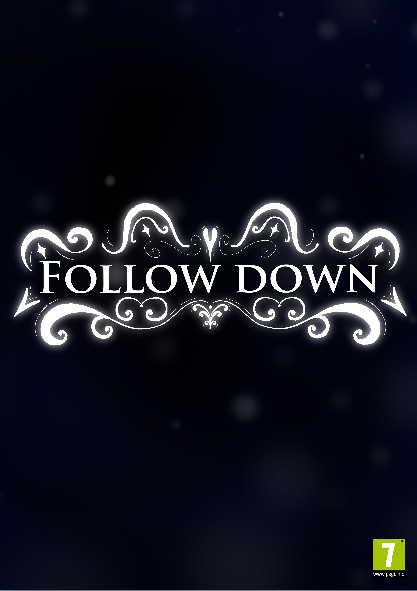

*Figura 1. Imagen promocional del juego.*

---

## 2. Especificaciones básicas

| **Título** | Follow Down |
| **Género** | Plataformas cooperativo, puzles |
| **Número de jugadores** | 2 jugadores en red, tiempo real |
| **Público objetivo** | Jugadores casuales a partir de 8 años. Ideal para familias! |
| **Clasificación PEGI** | PEGI 7 (Es un juego "family-friendly", por lo que el único incoveniente real es la dificultad de los puzles y desafíos) |
| **Plataforma** | Navegador web (PC), desarrollado con Phaser 3 |
| **Duración de una partida** | A partir de 5 minutos |
| **Representación** | 2D |
| **Licencia** | Apache 2.0 |

---

## 3. Jugabilidad

### 3.1. Objetivo del juego

El objetivo de los jugadores, al ser un juego cooperativo, es mediante la comunicación y colaboración entre ellos, superar distintos niveles, los cuales tendrán una mezcla de desafíos únicos : puzles, saltos, combinaciones... La partida termina cuando ambos jugadores son capaces de llegar al final, superando dichos desafíos y obteniendo el coleccionable(s) necesario(s). Por tanto, ambos jugadores ganan/pierden a la vez. El reinicio del nivel se dará en caso de que alguno de los 2 jugadores "muera", o se reinicie por consenso. El juego tendrá una progresión por los niveles linealmente, aunque se pueda seleccionar el nivel entre los ya desbloqueados. Asimismo, el juego presentará distintos logros a través de sus niveles, con los cuales desbloquearán nuevos estilos.

### 3.2. Controles

| Moverse a la izquierda | `A` | `←` |
| Moverse a la derecha | `D` | `→` |
| Saltar | `W` | `↑` |
| Agacharse | `Shift` | `L` |
| Coger/Soltar Objeto | `Espacio` | `P` |
| Interactuar con los botones dentro/fuera del nivel | Ratón (clic izquierdo) | Ratón (clic izquierdo) |
| Pausa / Reanudar | `Esc` | `Esc` |
| Reiniciar Nivel | `R` | `R` |

### 3.3. Mecánicas

#### 3.3.1. Mecánicas principales

- **AAA:** AAA AAA AAA AAA AAA AAA.
- **BBB:** BBB BBB BBB BBB BBB BBB.
- **CCC:** CCC CCC CCC CCC CCC CCC.

#### 3.3.2. Objetos y power-ups

| Objeto | Efecto | Duración | Aparición |
| :--- | :--- | :---: | :--- |
| AAA | AAA AAA AAA | 5 s | Aleatoria cada 15 s |
| BBB | BBB BBB BBB | 10 s | Zona central del mapa |
| CCC | CCC CCC CCC | Instantáneo | Al derrotar a un enemigo |

#### 3.3.3. Sistema de puntuación

El nivel se completara si se recoge el recolectable principal. A la par, habrá disponibles otros recolectables secundarios con los que se desbloquearán estilos a lo largo del juego.

### 3.4. Físicas y dificultad

> *Rúbrica — Jugabilidad / Físicas:* físicas variadas con elementos de dificultad.

- **Gravedad y salto:** AAA AAA AAA.
- **Colisiones:** AAA AAA AAA (con plataformas, entre jugadores, con proyectiles...).
- **Rebotes / fricción / empujes:** AAA AAA AAA.
- **Plataformas móviles o superficies especiales (hielo, rebote...):** AAA AAA AAA.
- **Progresión de la dificultad:** a medida que avanza la partida AAA AAA AAA.

### 3.5. Escenario

El escenario representa un nivel jugable. Cada nivel es distinto al anterior, por lo que la colocación de los objetos, personajes, y objetivo variarán. Se componen de 4 zonas principalmente:

1. **Zona 1:** Zona(s) de aparición de los jugadores.
2. **Zona 2:** Zonas con desafíos, obstáculos, plataformas.
3. **Zona 3:** Zona(s) de aparición de objetos/coleccionables.
4. **Zona 4:** Zona de finalización del nivel.

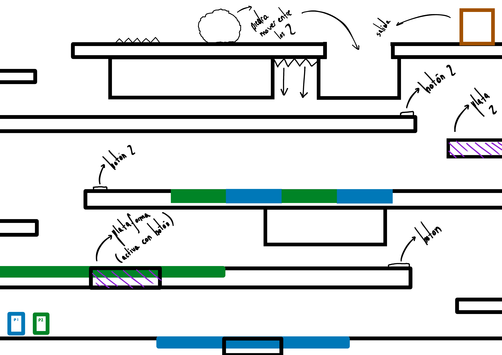

*Figura 2. Mapa del escenario con zonas de aparición, plataformas y obstáculos.*

---

## 4. Narrativa

### 4.1. Historia

Una familia muy normal de 5 integrantes, siendo Fika, Tonko y Lali los tres hijos de Nico y Tina. Un día cualquiera, estaban los tres hermanos fuera plantando bacterias y recogiendo alimentos por los alrededores para hacerles un buen plato de comida a sus padres, pero de repente, al adentrarse mucho en el claro prohibido un ciempiés malvado apareció y secuestró a Lali llevándosela a las profundidades de las cavernas. Fika y Tonko, aterrados fueron a avisar a sus padres. Sin embargo, se encontraron a su padre muy enfermo en cama y su madre socorriéndolo. Entonces, al no haber otra alternativa, tuvieron que adentrarse juntas en las cavernas para rescatar a su hermana perdida.

### 4.2. Personajes

#### FIKA (Jugador 1)

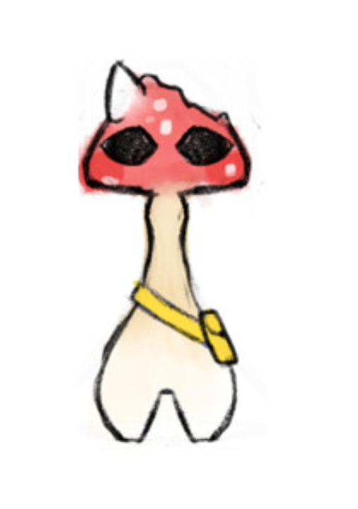

- **Edad / origen:** 5 años
- **Personalidad:** Una setita más tímida e inocente que es muy asustadiza con todo lo que se encuentra en las minas (Suele seguir a Take).
- **Motivación:** Recuperar a su tercer hermano perdido en las profundidades de las minas.
- **Habilidad especial:** No tiene habilidad especial específica.
- **Trasfondo:** Su familia fue separada por culpa de un ciempiés y ahora debe acompañar a su hermana y afrontar sus miedos para recuperarla.

#### TAKE (Jugador 2)

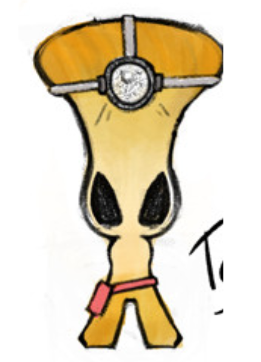

- **Edad / origen:** 5 años
- **Personalidad:** Una seta que es más valiente que Fika y suele adentrarse siempre a la aventura.
- **Motivación:** Recuperar a su tercer hermano perdido en las profundidades de las minas.
- **Habilidad especial:** No tiene habilidad especial específica.
- **Trasfondo:** Su familia fue separada por culpa de un ciempiés y ahora debe apoyar a su hermana para afrontar los peligros que encuentren en las cavernas.

---

## 5. Imagen y diseño visual

### 5.1. Logotipo

*Figura 3. Logotipo del juego. Tipografía: Trajan Pro. Concepto: El logo se ha desarrollado pensando en la estética de un hongo brillante que resalta en la oscuridad.*

### 5.2. Estilo visual

El juego utiliza un estilo oscuro, melancólico, con ciertos toques luminosos o fluorescentes, dando la similitud al mundo subterráneo, lúgubre y apagado del que proceden los protagonistas.

### 5.3. Uso de colores

> *Rúbrica — Imagen / Descripción visual:* uso de colores.

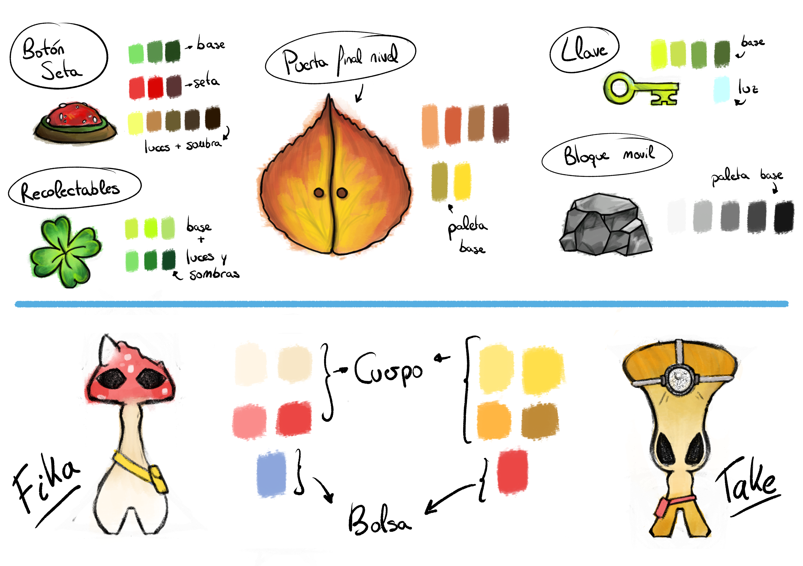

*Figura 4. Paleta de colores del juego.*

- **Fondo (`#1B1F3B`):** AAA AAA AAA.
- **Jugador 1 (`#E94560`) / Jugador 2 (`#0F9BD7`):** colores complementarios para distinguir fácilmente a cada jugador.
- **Objetos (`#F5C518`):** AAA AAA AAA.

### 5.4. Aspectos técnicos: cámara y representación

- **Representación:** 2D, vista lateral.
- **Cámara:** Seguimiento a los jugadores con *zoom* dinámico.
- **Resolución base:** 1920 × 1080 píxeles.

### 5.5. Inspiración artística y cultural

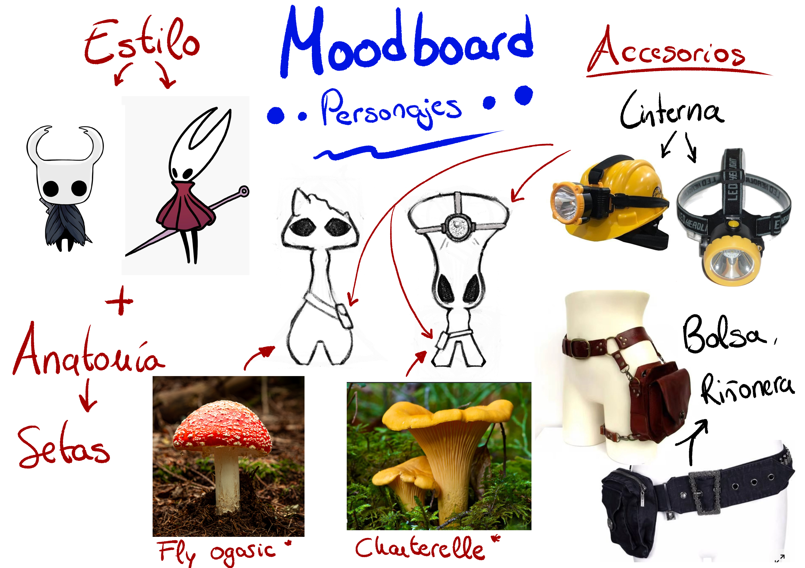

*Figura 5. Moodboard con las referencias visuales.*

- **AAA** (Hollow Knight, 2017): tomamos como referencia la estética y el estilo visual que usan en el juego.
- **AAA** (Pico Park, 2019): tomamos la jugabilidad y el diseño de niveles.
- **BBB** (Water Girl and Fire boy): tomamos la jugabilidad y el diseño de niveles.
- **CCC** (referencia cultural): CCC CCC CCC.

### 5.6. Bocetos de personajes y pantallas

Los bocetos de los personajes se encuentran en el apartado [4.2](#42-personajes) y los de las pantallas en el apartado [7.1](#71-pantallas).

---

## 6. Sonido

### 6.1. Banda sonora

| Pista | Escena | Estilo / ambiente | Fuente / licencia |
| :--- | :--- | :--- | :--- |
| AAA | Menú principal | Enter Hollownest | (propia / CC-BY: Christopher Larkin) |
| CCC | Sala de espera | Greenpath | (propia / CC-BY: Christopher Larkin) |
| CCC | Selector de nivel | The White Lady | (propia / CC-BY: Christopher Larkin) |
| BBB | Nivel | Fungal Waste | (propia / CC-BY: Christopher Larkin) |
| CCC | Victoria | Happy wheels victoria | (propia / CC-BY: Jack Zankowski) |

### 6.2. Efectos de sonido

| Efecto | Momento en que se reproduce |
| :--- | :--- |
| Salto | Al pulsar la tecla de salto |
| Caída | Al morir un personaje |
| Recoger objeto | Recoger/Soltar objeto |
| Botones de la interfaz | Al hacer clic |
| Coleccionable | Al recoger coleccionable |

---

## 7. Interfaz y diagrama de flujo

### 7.1. Pantallas

**Menú principal**

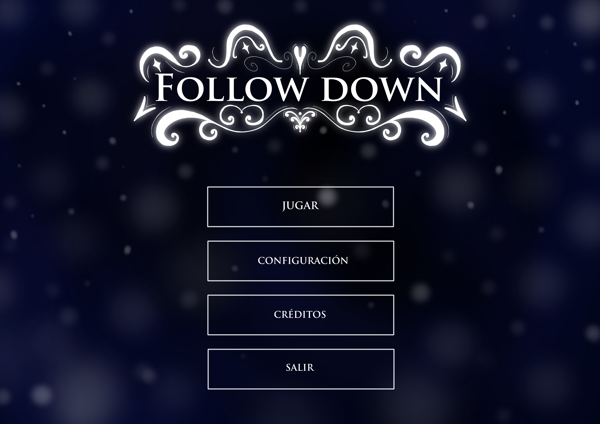

*Figura 6. Menú principal: Follow Down*

**Pantalla de juego (HUD)**

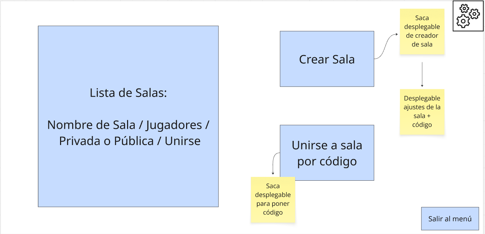

*Figura 7. Pantalla de juego: Creación de salas.*

*Figura 8. Pantalla de juego: Creación de salas, desarrollada.*

**Pantalla de juego 2 (HUD)**

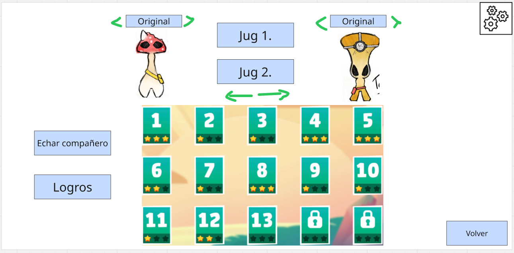

*Figura 9. Pantalla de juego: Selector de niveles.*

**Ajustes y pausa**

  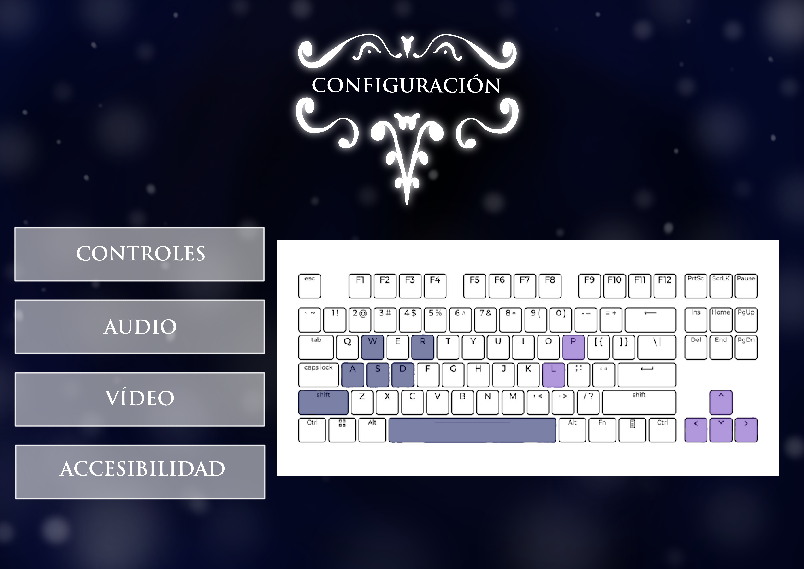
  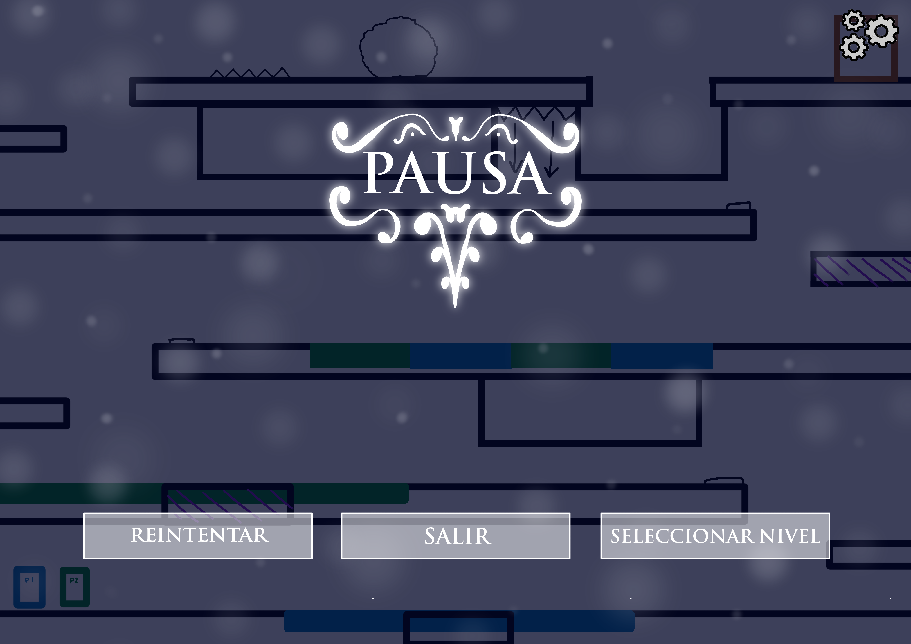

*Figura 10. Pantalla de ajustes (izquierda) y fin de partida (derecha).*

### 7.2. Diagrama de flujo

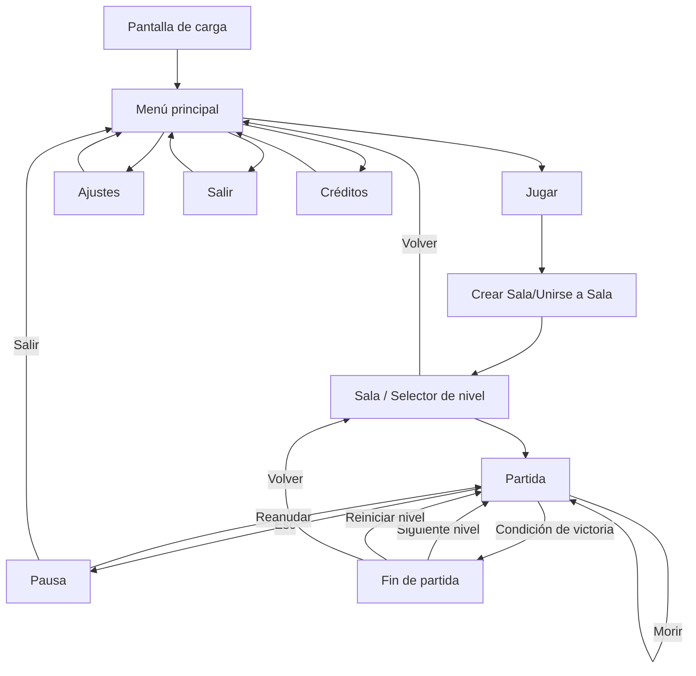

*Figura 11. Diagrama de flujo entre pantallas.*

---

## 8. Comunicación y marketing

- **Público y mensaje clave:** Publico infantil y familiar (PEGI 7) "la colaboración hace la fuerza".
- **Canales:** redes sociales (Intagram, Twitter), itch.io, Newgrounds, Game Jolt...
- **Calendario:** *teaser* en 2026, *devlog* semanal en 2026, lanzamiento en 2027.
- **Material:** tráiler, capturas, GIF de jugabilidad, *press kit*.
- **Eslogan:** «Seta-bien».

---

## 9. Referencias

> *Rúbrica — Documento / Referencias.* Usad un formato consistente (p. ej. APA) y citadlas en el texto con [1], [2]...

[1] AAA, A. (Año). *Título de la obra*. Editorial / Estudio. URL

[2] BBB, B. (Año). *Título del artículo*. Revista, volumen(número), páginas. https://doi.org/AAA

[3] Schell, J. (2019). *The Art of Game Design: A Book of Lenses* (3.ª ed.). CRC Press.

[4] Phaser Studio. (s. f.). *Phaser 3 Documentation*. https://docs.phaser.io

[5] Recursos de terceros utilizados (sprites, música, fuentes): AAA — autor — licencia — URL.
