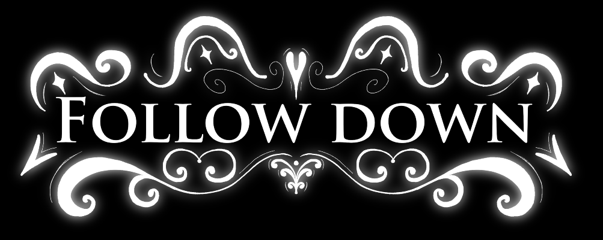

Logotipo del Juego

Imagen promocional / key art del juego

Mapa del escenario (1 nivel)

Boceto personajes

Boceto enemigo (si tenemos)

Paleta de colores

Moodboard

Menú principal

Boceto pantalla del juego

Boceto Ajustes

Boceto Fin de partida (Cambiar a otra pantalla? Si no, hacer soft lock)

Diagrama de flujo

  

# AAA --- Nombre del juego

**Juegos en Red · Grado en Diseño y Desarrollo de Videojuegos · URJC · Curso 2026/27** 
**Grupo I**

## Descripcion de la temática

--- es un juego multijugador de puzles y plataformas cooperativo para 2 o más jugadores en el que los jugadores deben unir fuerzas (o no!) a través de distintos niveles, resolviendo distintos puzles y parkours, con tal de conseguir las distintas gemas esparcidas por los niveles. Ambos jugadores deberán resolver los niveles en conjunto, mediante la colaboración y comunicación mutua.

## Equipo de desarrollo

| Álvaro Montero Carrasco | a.monteroc.2024@alumnos.urjc.es | `@varoo20` |
| Carla Urdiales Aguado | c.urdiales.2024@alumnos.urjc.es | `@alumno2-ejemplo` |
| Jorge Franco Lopez de Gauna | j.francol.2024@alumnos.urjc.es | `@Hermenegildo305` |

**Repositorio:** `(https://github.com/varoo20/Grupo-I---Juegos-en-Red)`

**Licencia:** [Apache 2.0](LICENSE)

---

## Game Design Document

📄 El documento de diseño completo está en **[GDD.md](GDD.md)**.

Apartados principales:

- [Especificaciones básicas](GDD.md#2-especificaciones-básicas)
- [Jugabilidad](GDD.md#3-jugabilidad)
- [Narrativa](GDD.md#4-narrativa)
- [Imagen y diseño visual](GDD.md#5-imagen-y-diseño-visual)
- [Sonido](GDD.md#6-sonido)
- [Interfaz y diagrama de flujo](GDD.md#7-interfaz-y-diagrama-de-flujo)
- [Comunicación y marketing](GDD.md#8-comunicación-y-marketing)
- [Referencias](GDD.md#9-referencias)

---

## Fases del proyecto

| Fase 1 | Equipo, temática y GDD | ✅ Entregada |
| Fase 2 | Juego en local | ⏳ Pendiente |
| Fase 3 | API REST | ⏳ Pendiente |
| Fase 4 | WebSockets | ⏳ Pendiente |
